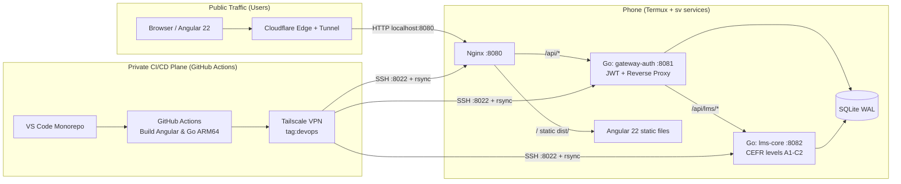

# lms-app — Architecture Overview

A monorepo for a CEFR-based Learning Management System (LMS). It ships an Angular 22 web client and two Go services (`gateway-auth` and `lms-core`), deployed on a Termux phone behind Nginx, with CI/CD via GitHub Actions over Tailscale.

## Repository Layout

```
lms-app/
├── ARCHITECTURE-LMS-APP.mmd      # Original topology diagram (Spanish)
├── lms-app.md                    # This document
├── .github/workflows/
│   ├── deploy-frontend.yml       # Angular build + rsync + nginx reload
│   ├── deploy-gateway-auth.yml   # Gateway ARM64 build + deploy + sv restart
│   └── deploy-lms-core.yml       # Core ARM64 build + deploy + sv restart
├── backend/
│   ├── go.work                   # Go workspace (Go 1.27.4)
│   ├── gateway-auth/             # Auth service (JWT, reverse proxy)
│   │   ├── cmd/api/main.go       # Startup: SQLite + migrations, DI, graceful shutdown
│   │   └── internal/{config, model, service, store, transport}
│   ├── lms-core/                 # Pedagogy service (CEFR levels A1–C2)
│   │   ├── cmd/api/main.go       # Startup: SQLite + migrations, DI, server timeouts
│   │   └── internal/{config, model, store, transport}
│   └── shared/                   # go.mod only — planned shared code (no .go files yet)
├── deploy/nginx.conf             # Reverse proxy + static serving config
└── frontend/                     # Angular app "lms-web"
    ├── angular.json              # Project lms-web; output dist/lms-web/browser/
    ├── proxy.conf.json           # Dev proxy: /api → http://127.0.0.1:8081
    └── src/app
        ├── core/{guards, interceptors, models, services, store}
        └── features
            ├── auth/{login, register}
            └── dashboard
```

## Technology Stack

| Layer | Technology |
|---|---|
| Frontend | Angular 22.3, TypeScript ~6.0.2, pnpm 12.21.0, @ngrx/signals, RxJS 7.8, Tailwind CSS 4, SCSS, Vitest |
| Backend | Go 1.27.4 (single `go.work`), standard library `net/http`, `log/slog`, SQLite (WAL) |
| Auth | JWT (HS-style) issued by gateway-auth; access token 15 min, refresh token 7 days |
| Reverse proxy | Nginx (static + `/api/` → gateway) + Go `httputil.ReverseProxy` (gateway → core) |
| Edge | Cloudflare Edge + Tunnel (HTTPS termination, tunnel to `localhost:8080`) |
| Runtime | Termux on a phone (Tecno Pova 4); services supervised by `sv` |
| CI/CD | GitHub Actions (ARM64 Linux builds, `CGO_ENABLED=0`), Tailscale SSH (`-p 8022`) + rsync |

## Architecture Diagram



> Note: the original `ARCHITECTURE-LMS-APP.mmd` labels the phone runtime as "PM2" and the Tailscale tag as `tag:ci`. The actual workflows use `sv` service restarts and the `tag:devops` tag; this document reflects the code.

## Connections & Ports

| Port | Service | Role |
|---|---|---|
| 8080 | Nginx | Public entry point: serves Angular static files, proxies `/api/` → gateway, `/health` → gateway, SPA fallback |
| 8081 | gateway-auth | Auth API + JWT validation + reverse proxy to lms-core |
| 8082 | lms-core | CEFR level API (internal; trusted-gateway middleware) |

Request flow:

```
Browser → Cloudflare Tunnel → Nginx :8080
        ├── /, /assets, ...        → static dist/lms-web/browser/ (30d immutable cache)
        ├── /api/*                 → gateway-auth :8081
        │    ├── /api/auth/*       → auth handlers (register/login/refresh public; me/logout/password JWT-protected)
        │    └── /api/lms/*        → JWT check → reverse proxy → lms-core :8082
        └── /health                → gateway health check
```

Development: the Angular dev server (`proxy.conf.json`) proxies `/api` directly to `http://127.0.0.1:8081`, bypassing Nginx.

## API Routes

### gateway-auth (port 8081)

| Method | Path | Auth |
|---|---|---|
| GET | `/health` | none |
| POST | `/api/auth/register` | public |
| POST | `/api/auth/login` | public |
| POST | `/api/auth/refresh` | public |
| GET | `/api/auth/me` | JWT |
| POST | `/api/auth/logout` | JWT |
| PATCH | `/api/auth/password` | JWT |
| ANY | `/api/lms/*` | JWT, then proxied to lms-core |

### lms-core (port 8082)

| Method | Path | Auth |
|---|---|---|
| GET | `/health` | none |
| GET | `/api/lms/levels` | TrustedGatewayMiddleware (internal trust boundary) |

`GET /api/lms/levels` returns the CEFR levels (A1–C2) and determines the student's current numeric rank (default 1 = A1 if not found in the database).

## Database

Both Go services use **SQLite in WAL mode** via `store.NewSQLiteDB`, opened at startup with a 10-second migration timeout (`RunMigrations`):

| Service | File (default) | Contents |
|---|---|---|
| gateway-auth | `./data/gateway-auth.db` | Users, credentials, auth state |
| lms-core | `./data/lms-core.db` | CEFR levels, student rank data |

> The original diagram labels the database as "SQLite WAL / PostgreSQL". The current code uses SQLite only; PostgreSQL is a future possibility but not wired in.

## Configuration (Environment Variables)

### gateway-auth

| Variable | Default | Notes |
|---|---|---|
| `APP_ENV` | `development` | `production` enables strict checks |
| `GATEWAY_PORT` | `8081` | Listen port |
| `GATEWAY_DB_PATH` | `./data/gateway-auth.db` | SQLite path |
| `JWT_SECRET` | dev placeholder | **Must be ≥ 32 chars in production** (panics otherwise) |
| `LMS_CORE_URL` | `http://127.0.0.1:8082` | **Must use HTTPS in production** |
| `COOKIE_DOMAIN` | *(empty)* | Cookie domain for tokens |

Fixed values: access token TTL **15 min**, refresh token TTL **7 days**, `CookieSecure` enabled in production. The reverse proxy validates the target URL scheme (http/https only) and warns on private/loopback targets (SSRF defense-in-depth).

### lms-core

| Variable | Default |
|---|---|
| `APP_ENV` | `development` |
| `LMS_CORE_HOST` | `127.0.0.1` |
| `LMS_CORE_PORT` | `8082` |
| `LMS_CORE_DB_PATH` | `./data/lms-core.db` |

Both services log via `log/slog` (text format) and shut down gracefully on SIGTERM/SIGINT. lms-core's HTTP server uses read timeout 10s, write timeout 15s, idle timeout 60s. Both routers wrap handlers in panic-recovery middleware.

## Deployment

**Target:** Termux on the phone (Tecno Pova 4).

| Artifact | Destination |
|---|---|
| `gateway-auth` binary (ARM64, `CGO_ENABLED=0`) | `~/apps/lms-app/gateway-auth/gateway-auth` |
| `lms-core` binary (ARM64, `CGO_ENABLED=0`) | `~/apps/lms-app/lms-core/lms-core` |
| Angular build (`frontend/dist/lms-web/browser/`) | `~/apps/lms-app/frontend/` (Nginx static root) |
| `deploy/nginx.conf` | `/data/data/com.termux/files/usr/etc/nginx/nginx.conf` |

**Services** (managed via `sv`, SVDIR `/data/data/com.termux/files/usr/var/service`):

- `lms-gateway` — gateway-auth binary
- `lms-core` — lms-core binary
- `cloudflared` — Cloudflare tunnel to `localhost:8080`

**CI/CD (GitHub Actions):** three workflows, one per deployable. All trigger on push to `develop` (with path filters) and `workflow_dispatch`, with concurrency groups per workflow. Each builds the artifact for ARM64 Linux, deploys over Tailscale SSH (`-p 8022`) using rsync, and restarts the corresponding `sv` service (frontend also reloads Nginx).

**Required GitHub secrets:** `VPS_SSH_KEY`, `VPS_USER_POVA`, `VPS_POVA_TS_IP`, `TS_OAUTH_CLIENT_ID`, `TS_OAUTH_SECRET`.

## Security Model

1. **Public → Edge:** Cloudflare provides TLS termination and tunneling to the phone.
2. **Nginx → Gateway:** Nginx is the single public HTTP entry; it never talks directly to lms-core.
3. **Gateway auth boundary:** JWT middleware protects all `/api/auth/*` private routes and every `/api/lms/*` request before proxying.
4. **Gateway → Core trust boundary:** lms-core sits behind `TrustedGatewayMiddleware`, so its endpoints are only reachable through the authenticated gateway (not exposed publicly).
5. **Token hygiene:** short-lived access tokens (15 min) + refresh rotation (7 days); secure cookies in production; strong JWT secret enforced.
6. **SSRF guard:** the Go reverse proxy rejects non-http(s) schemes and warns on private/loopback targets.

## Frontend Notes

- Project name `lms-web`; production build output `frontend/dist/lms-web/browser/`.
- Production budgets: initial ≤ 500 kB warning / 1 MB error; component styles ≤ 4 kB warning / 8 kB error; `outputHashing: all`.
- State management via signals (`@ngrx/signals`); feature routes are lazy-loaded.
- Core layer: guards, interceptors (API), models, services, store; features: `auth/login`, `auth/register`, `dashboard`.
